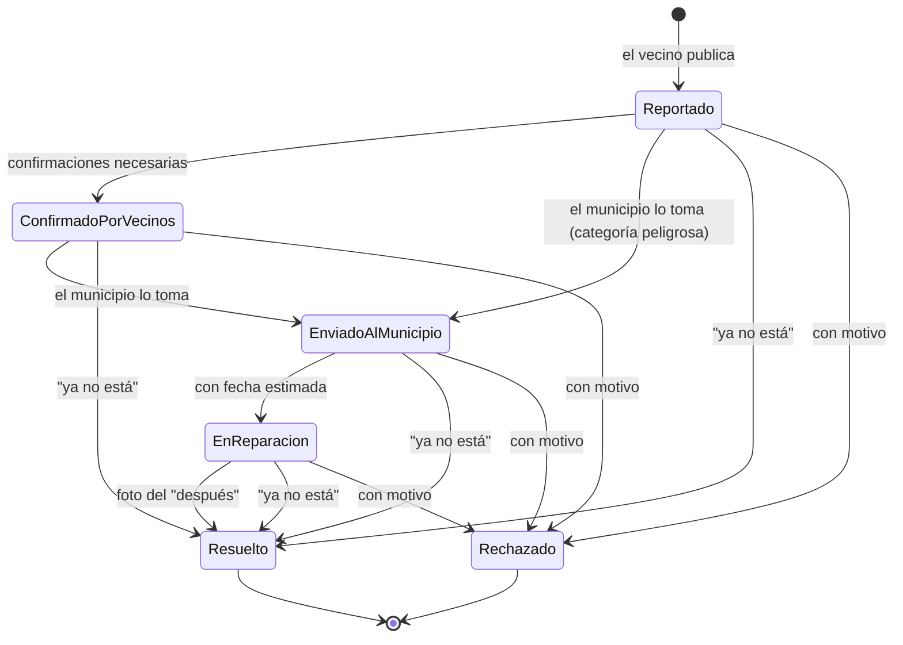

# Pozo

> Reclamos urbanos hiperlocales: fotografiás el problema de tu cuadra, tus vecinos lo
> confirman y el municipio lo gestiona como un expediente.

TP de Apps Móviles, UCA. App móvil hecha con Expo y React Native, con un backend propio en el repo
[pozo-backend](https://github.com/nicocoloritto/pozo-backend).

## Qué es Pozo

Un pozo en la esquina, una vereda rota, una luminaria apagada: todos lo ven, pocos lo reportan y
casi nadie sabe si el reclamo llegó a algún lado. Pozo resuelve las dos puntas. El **vecino**
reporta con una foto sacada con la cámara de la app y la ubicación real del teléfono, y los demás
vecinos lo **confirman** con un toque. El **municipio** tiene su propio panel dentro de la misma
app, con una bandeja ordenada por severidad, un mapa y las herramientas para gestionar cada reclamo
como un expediente, con número de caso, historial y fechas.

## Cómo correrlo

### Requisitos

- Node.js (versión LTS) y npm. El backend pide Node 20.19 o más nuevo.
- La app **Expo Go** en el celular, en una versión compatible con el SDK 57.
- Celular y computadora en la misma red Wi-Fi.

### 1. Backend

La app necesita el servidor: sin él no hay login ni reclamos.

```bash
git clone https://github.com/nicocoloritto/pozo-backend.git
cd pozo-backend
npm install
cp .env.example .env     # en Windows: copy .env.example .env
npm run setup            # crea la base y carga los datos de prueba
npm run dev              # http://localhost:3000
```

Para volver a los datos de prueba originales, en el backend: `npm run db:reset`. Borra la base y
la vuelve a cargar. Más detalle en el README del backend.

### 2. App

```bash
cd mobile
npm install
npx expo start
```

Escaneá el QR con la cámara (iOS) o desde Expo Go (Android). En desarrollo la app encuentra al
servidor sola: usa la IP de la computadora que le da Expo y el puerto 3000. Si usás `--tunnel` o
el servidor está en otro lado, definí la dirección antes de arrancar (hay un ejemplo en
`mobile/.env.example`):

```bash
EXPO_PUBLIC_API_URL=http://192.168.0.10:3000 npx expo start
```

## Usuarios de prueba

Los carga el backend con `npm run setup`. La contraseña de todos es `123456`.

| Email | Rol |
|---|---|
| `vecino1@pozo.com` | Vecino (Lucía, Caballito) |
| `vecino2@pozo.com` | Vecino (Martín, Palermo) |
| `vecino3@pozo.com` | Vecino (Noelia, Flores) |
| `admin@caba.gob.ar` | Municipio (CABA) |

También se puede crear una cuenta de vecino escaneando el PDF417 del DNI. Los admin no se
registran desde la app. Un DNI solo puede tener una cuenta: si se escanea uno ya registrado, la
app ofrece iniciar sesión.

Las cuentas y los reclamos viven en el servidor, así que se puede publicar un reclamo como
`vecino1` y gestionarlo después como `admin@caba.gob.ar`, desde cualquier teléfono conectado al
mismo servidor. Cerrar sesión solo descarta la sesión del teléfono. Desde Perfil → "Eliminar mi
cuenta" el vecino borra sus datos personales y libera el DNI; sus reclamos siguen, sin su nombre.
Después de 5 contraseñas incorrectas seguidas el servidor bloquea el login de esa cuenta por 15
minutos.

## Circuito de estados



| Estado | Cómo se llega |
|---|---|
| Reportado | El vecino publica el reclamo. |
| Confirmado por vecinos | Otro vecino (nunca el autor) confirma "sigue ahí" y se alcanza el límite de confirmaciones. |
| Tomado por el municipio | El municipio lo toma y se le asigna sola el área de su categoría. Un reclamo `Reportado` solo se puede tomar si es de una categoría peligrosa: poste caído, árbol caído, corte de luz o agua y semáforo. (Internamente el estado se llama `EnviadoAlMunicipio`.) |
| En reparación | El municipio lo pasa a reparación y elige la fecha estimada, que no puede ser anterior a hoy. |
| Resuelto | El municipio sube la foto del "después" (sacada con la cámara), o lo resuelven los vecinos con "ya no está". |
| Rechazado | El municipio lo rechaza con un motivo de la lista: "No corresponde al municipio", "No requiere arreglo" o "Duplicado", más un detalle opcional. |

**Resuelto por los vecinos.** Cuando se alcanza el límite de votos "ya no está", un reclamo abierto
pasa solo a `Resuelto`, desde cualquier estado y sin foto. Queda en el historial como "Resuelto por
los vecinos" y cuenta como resuelto en las estadísticas. No es un rechazo.

`Resuelto` y `Rechazado` son estados finales.

**Aviso "Posiblemente resuelto".** Con 3 o más "ya no está" y más que "sigue ahí", el reclamo se
marca como posiblemente resuelto: lo ven el vecino en el detalle y el municipio en la bandeja y en
el detalle.

### Límites de votos

Los valores se definen en `src/domain/tipos.ts` del backend, y la app tiene una copia en
`mobile/types/reclamo.ts`:

- `CONFIRMACIONES_NECESARIAS` está en **1** solo para poder mostrar el flujo en la presentación con
  pocas cuentas. El valor pensado para uso real es **10**. Para cambiarlo hay que editar las dos
  copias; si no coinciden, la app muestra un contador distinto del que aplica el servidor.
- `VOTOS_YA_NO_ESTA_NECESARIOS` es **10**.
- El aviso "Posiblemente resuelto" usa `VOTOS_YA_NO_ESTA_PARA_AVISO` (3), solo en la app.

## Qué ve cada rol

### Vecino

Cinco tabs: Mapa, Reclamos, el botón de nuevo reclamo, Barrio y Perfil.

- **Registro con el DNI:** se escanea el PDF417 del dorso con la cámara y los datos se completan
  solos.
- **Nuevo reclamo:** foto con la cámara en vivo (no se elige de la galería), ubicación por GPS,
  categoría (pozo, vereda, semáforo, luminaria, poste, árbol o rama caída, zanja, luz/agua,
  residuos), severidad y notas. Si ya hay un reclamo abierto de la misma categoría a menos de 50 m,
  el servidor no lo publica: la app lo muestra para confirmarlo en lugar de duplicarlo, o publicar
  igual si es otro problema.
- **Mapa:** todos los reclamos, con filtros por categoría y estado. Los resueltos o rechazados hace
  más de 7 días no se muestran. Los reclamos cercanos se agrupan en un círculo con la cantidad; al
  tocarlo el mapa hace zoom, y si siguen juntos se muestra una lista para elegir. El panel "Cerca
  tuyo" lista los activos a menos de 500 m.
- **Reclamos:** lista de todos, con filtro por estado y "Solo míos".
- **Detalle:** línea de tiempo del expediente, foto, mapa, antes y después si se resolvió, y los
  votos "sigue ahí" / "ya no está". Mientras está Reportado muestra cuántos vecinos confirmaron sobre las confirmaciones necesarias.
- **Barrio:** estadísticas del barrio y su posición entre los barrios.
- **Perfil:** datos personales (el DNI se muestra enmascarado), cerrar sesión y eliminar la cuenta.

### Municipio

Cuatro tabs: Bandeja, Mapa, Tablero y Perfil.

- **Bandeja por secciones:** Nuevos (`Reportado` y `Confirmado por vecinos`), En gestión (`Tomado
  por el municipio` y `En reparación`) y Cerrados (`Resuelto` y `Rechazado`), cada una con su
  contador. Tiene búsqueda por dirección y filtros por barrio, comuna y categoría.
- **Semáforo por severidad:** cada fila lleva un ícono de alerta según la severidad que eligió el
  vecino: alta (rosa), media (mandarina) o baja (verde). La bandeja ordena primero las altas y,
  dentro de cada nivel, por la prioridad que calcula el servidor (confirmaciones, "ya no está" y
  días abiertos).
- **Atrasado por fecha estimada:** un reclamo con fecha estimada vencida y sin cerrar se marca
  "Atrasado" en la bandeja y en el detalle. Como la fecha solo se define en reparación, en la
  práctica son reclamos en reparación.
- **Mapa por secciones:** los mismos filtros más "Sección". Los pines se pintan según la sección
  de la bandeja (Nuevos mandarina, En gestión cobalto, Cerrados lima) y una tarjeta abre el
  detalle.
- **Acciones por estado** (en el detalle):

  | Estado | Acciones |
  |---|---|
  | Reportado | Tomar (solo si es de categoría peligrosa) y Rechazar |
  | Confirmado por vecinos | Tomar y Rechazar |
  | Tomado por el municipio | Pasar a reparación (con la fecha estimada) y Rechazar |
  | En reparación | Cambiar fecha, Resuelto (con la foto del "después") y Rechazar |
  | Resuelto, Rechazado | Ninguna; se ve el motivo del rechazo o que lo resolvieron los vecinos |

  En cualquier estado se pueden agregar notas públicas al expediente.
- **Tablero:** reclamos abiertos que requieren seguimiento, nuevos sin tomar, atrasados, porcentaje
  resuelto, días promedio, reclamos por área y por estado, evolución de los últimos 6 meses y
  ranking de barrios por porcentaje de resolución.

## Stack

| Pieza | Elección |
|---|---|
| App | **Expo** (SDK 57) + React Native + TypeScript |
| Navegación | **expo-router**: rutas por archivos, con grupos de tabs separados para vecino y municipio |
| Cámara | **expo-camera**: foto del reclamo y lectura del PDF417 del DNI. La foto del "después" usa la cámara de **expo-image-picker** |
| Ubicación | **expo-location**: GPS y dirección aproximada |
| Mapa | **react-native-maps** (Apple Maps en iOS, Google Maps en Android) |
| Agrupado de marcadores | **supercluster** |
| Servidor | API propia ([pozo-backend](https://github.com/nicocoloritto/pozo-backend): Express, Prisma y SQLite). La app guarda solo el token de sesión, en **AsyncStorage** |
| Gráficos y sellos | react-native-svg |

Cómo está armada la app:

- Las pantallas nunca llaman a la red: usan funciones de `services/`, que hablan con el servidor a
  través de `services/api.ts`. Las reglas (estados, confirmaciones, permisos, prioridad, atrasado)
  las aplica el servidor; la app solo valida lo mínimo para avisar rápido.
- La máquina de estados (`lib/maquinaEstados.ts`) y la distancia entre reclamos (`lib/distancia.ts`)
  son funciones puras.
- `AuthProvider` lee el token y el usuario guardados al montar y recién entonces marca
  `isHydrated`.
- Colores, tipografías y espaciado salen de `mobile/theme/`.
- El mapa del vecino y el del municipio comparten el componente `ReclamosMap`.

## Estructura de carpetas

```
mobile/
  app/             Pantallas y rutas (expo-router)
    (tabs)/        Tabs del vecino: Mapa, Reclamos, Nuevo, Barrio, Perfil
    (admin)/       Tabs del municipio: Bandeja, Mapa, Tablero, Perfil
    reclamos/      Nuevo reclamo, reclamo publicado y detalle del vecino
    admin-reclamo/ Detalle con gestión del municipio
  components/      Piezas reutilizables (mapa, marcadores, sellos, modales)
  constants/       Etiquetas en español, íconos y colores de estados y categorías
  contexts/        AuthContext (sesión) y CatalogoContext (municipios y áreas)
  hooks/           Ubicación del usuario
  lib/             Reglas puras (estados, distancia, filtros, verificación, DNI)
  services/        Llamadas a la API (pozo-backend)
  theme/           Colores, tipografías y espaciado
  types/           Tipos compartidos
  assets/          Íconos, y en reclamos/ el índice de fotos de los reclamos de prueba
docs/              Diseño funcional, decisiones, capturas y entregas
```

## Componentes nativos

- **Cámara en vivo:** el reclamo nuevo se fotografía con `CameraView` de expo-camera, y la foto del
  "después" se saca con la cámara del sistema. En ningún caso se elige una imagen de la galería.
- **Ubicación:** `expo-location` pide permiso "mientras se usa la app", toma las coordenadas al
  disparar la foto y resuelve una dirección aproximada. La ubicación nunca se escribe a mano.
- **Escaneo del DNI:** en el registro, `CameraView` lee el código PDF417 del dorso del DNI
  (`trámite@apellido@nombres@sexo@dni@ejemplar@nacimiento@emisión`). Del código la app usa apellido,
  nombres, sexo, número de documento y fecha de nacimiento; descarta el número de trámite y el
  ejemplar.

## Documentación

- [`docs/decisiones.md`](docs/decisiones.md): qué decidimos, por qué y dónde está en el código
  (prioridad, atrasado, duplicados, registro y flujo de estados).
- [`docs/diseno-funcional.md`](docs/diseno-funcional.md): roles, estados, reglas de negocio y
  comportamiento de cada pantalla.
- [`docs/capturas/`](docs/capturas): capturas de las pantallas del vecino y del municipio.
- Entrega del Sprint 1, en [`docs/Entrega-Sprint1/`](docs/Entrega-Sprint1): presentación y mockup.

## Equipo

- Martín Allende ([@martinallende02](https://github.com/martinallende02))
- Nicolas Coloritto ([@nicocoloritto](https://github.com/nicocoloritto))
- Isidro Pasman ([@isidropasman](https://github.com/isidropasman))
